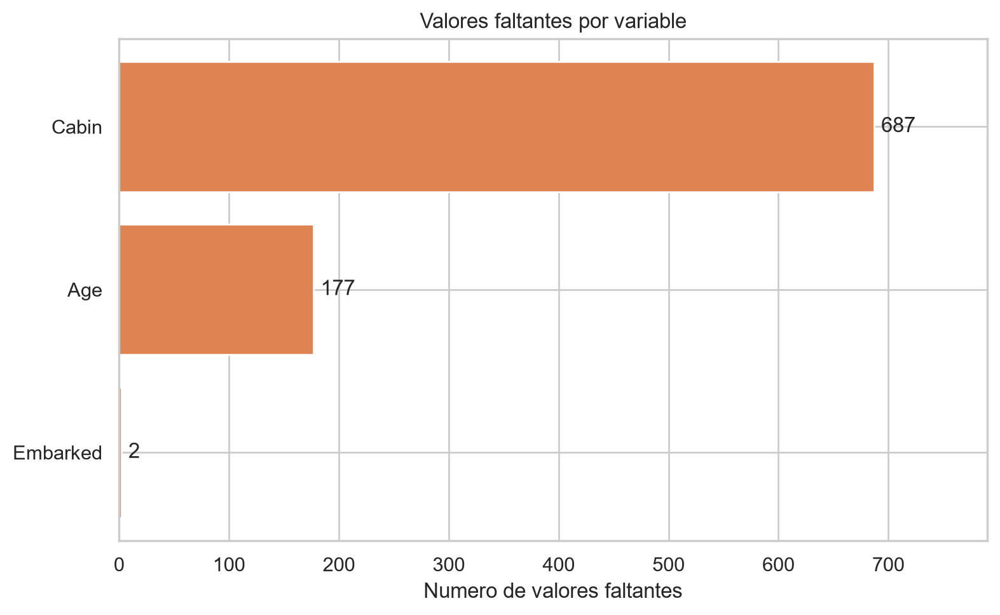
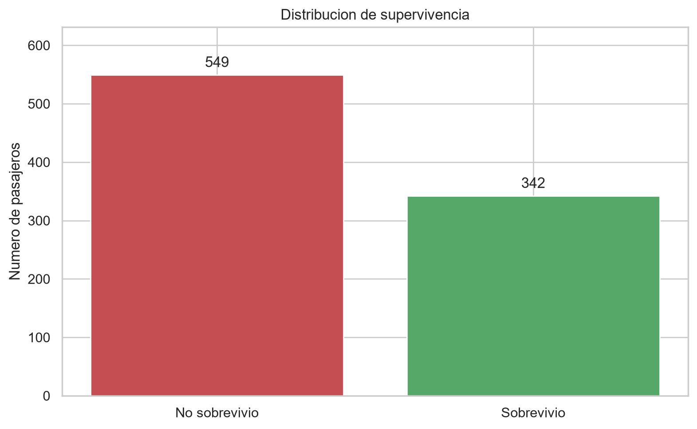
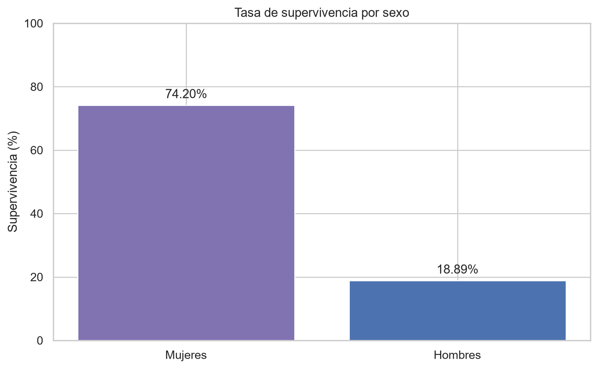
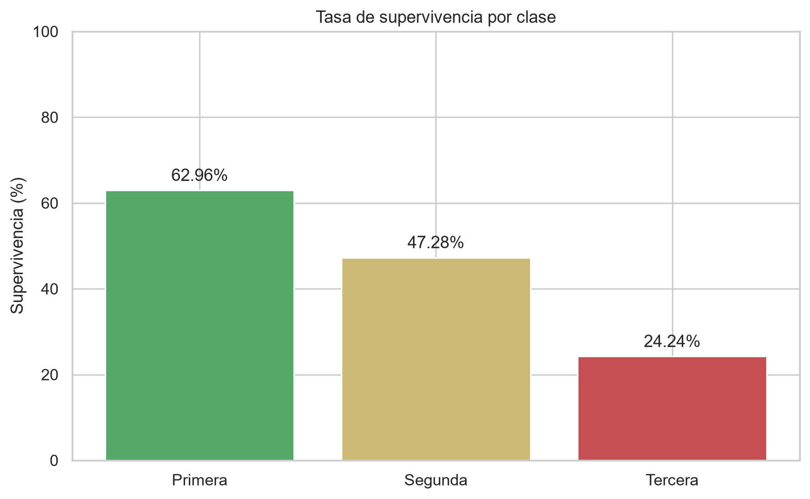
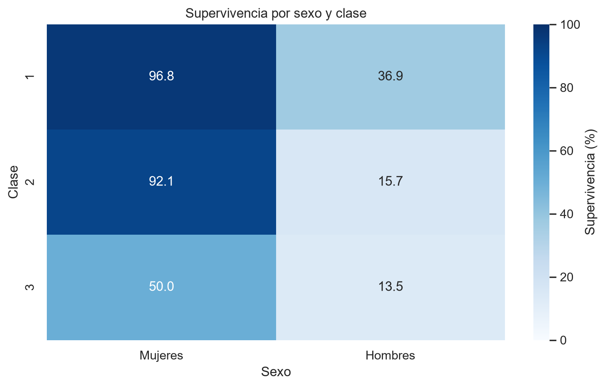
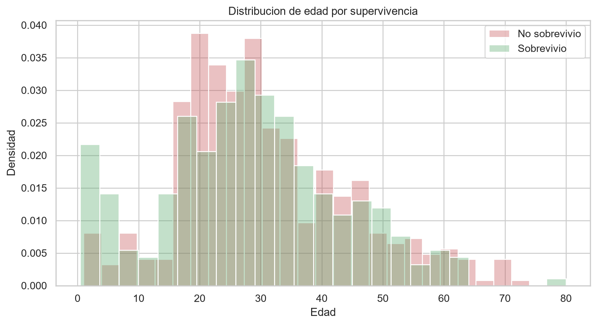
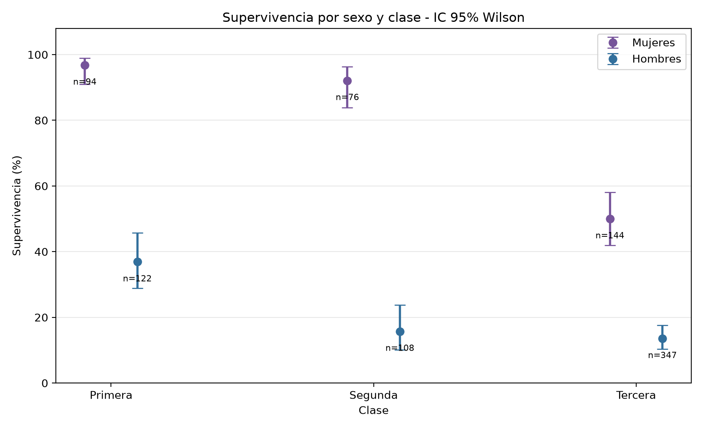

# Titanic — Análisis Exploratorio de Datos e Inferencia Estadística

- **Universidad Yachay Tech**
- **Maestría en Ciencia de Datos**
- **Asignatura:** Fundamentos de Inteligencia Artificial
- **Autor:** Héctor Alexander Román Potosí
- **Fecha:** octubre de 2026

## 1. Descripción

Este proyecto analiza el conjunto de datos **Titanic** mediante exploración de datos (EDA), auditoría de calidad, visualizaciones e inferencia estadística. El análisis principal se desarrolla en un notebook Jupyter; se incluyen programas reproducibles, resultados exportados y pruebas automatizadas.

**Entregable principal:** [`notebooks/EDA_Titanic_Entrega.ipynb`](notebooks/EDA_Titanic_Entrega.ipynb).

## 2. Objetivos

- Describir la estructura, los tipos de variables y las características de los pasajeros.
- Cuantificar valores faltantes, duplicados e inconsistencias.
- Explorar diferencias de supervivencia según sexo, clase y edad.
- Visualizar distribuciones y relaciones usando Matplotlib y Seaborn.
- Analizar asociaciones mediante la prueba chi-cuadrado y el tamaño del efecto V de Cramér.
- Cuantificar la incertidumbre con intervalos de confianza del 95 %.
- Mantener el análisis reproducible y verificable con pruebas automatizadas.

## 3. Datos y controles de calidad

El archivo [`data/titanic.csv`](data/titanic.csv) contiene **891 pasajeros** y **12 columnas**. La variable `Survived` vale `1` cuando el pasajero sobrevivió y `0` cuando no sobrevivió.

| Indicador | Resultado |
|---|---:|
| Pasajeros | 891 |
| Supervivientes | 342 |
| No supervivientes | 549 |
| Tasa de supervivencia | 38,38 % |
| Filas completamente duplicadas | 0 |
| Identificadores de pasajeros duplicados | 0 |

### Valores faltantes

| Variable | Registros faltantes | Porcentaje |
|---|---:|---:|
| `Cabin` | 687 | 77,10 % |
| `Age` | 177 | 19,87 % |
| `Embarked` | 2 | 0,22 % |

Los valores faltantes se describen sin eliminarlos ni imputarlos automáticamente. Las decisiones de tratamiento deben justificarse según el objetivo del análisis.



## 4. Resultados exploratorios

### Supervivencia general

Sobrevivieron **342 de 891 pasajeros (38,38 %)** en este conjunto de datos.



### Supervivencia por sexo

| Sexo | Pasajeros | Supervivientes | Tasa |
|---|---:|---:|---:|
| Mujeres | 314 | 233 | 74,20 % |
| Hombres | 577 | 109 | 18,89 % |

La diferencia observada es de aproximadamente **55,31 puntos porcentuales**.



### Supervivencia por clase

| Clase | Pasajeros | Supervivientes | Tasa |
|---|---:|---:|---:|
| Primera | 216 | 136 | 62,96 % |
| Segunda | 184 | 87 | 47,28 % |
| Tercera | 491 | 119 | 24,24 % |



### Análisis conjunto de sexo y clase

| Clase | Mujeres | Hombres |
|---|---:|---:|
| Primera | 96,81 % | 36,89 % |
| Segunda | 92,11 % | 15,74 % |
| Tercera | 50,00 % | 13,54 % |

La asociación observada entre sexo y supervivencia sigue siendo visible al separar los datos por clase. Esto es un análisis descriptivo, no una demostración de causalidad.



### Edad y supervivencia

Se representan las distribuciones de edad de quienes sobrevivieron y de quienes no sobrevivieron. Como el gráfico utiliza **densidades normalizadas por grupo**, no debe interpretarse como probabilidad de supervivencia condicionada a la edad.



## 5. Inferencia estadística

Se realizaron pruebas chi-cuadrado de independencia **sin corrección de continuidad**, acompañadas por V de Cramér para describir el tamaño de asociación.

| Variable | χ² | Grados de libertad | Valor p | V de Cramér |
|---|---:|---:|---:|---:|
| Sexo | 263,051 | 1 | 3,712 × 10⁻⁵⁹ | 0,543 |
| Clase | 102,889 | 2 | 4,549 × 10⁻²³ | 0,340 |

Ambas variables muestran evidencia estadística de asociación con la supervivencia en estos datos. El tamaño de asociación es mayor para sexo que para clase según V de Cramér.

La diferencia entre las tasas de supervivencia de mujeres y hombres fue **55,31 puntos porcentuales**, con intervalo de confianza normal aproximado del 95 % entre **49,51 y 61,11 puntos porcentuales**. Los intervalos para cada combinación de sexo y clase se calcularon mediante el método de Wilson.



**Precaución metodológica:** asociación no implica causalidad; la generalización inferencial a otras poblaciones depende de supuestos de muestreo que este conjunto de datos no garantiza necesariamente.

## 6. Estructura del proyecto

```text
Proyecto 1/
├── data/
│   └── titanic.csv
├── notebooks/
│   └── EDA_Titanic_Entrega.ipynb
├── src/
│   ├── 01_auditoria.py
│   ├── 02_visualizaciones.py
│   └── 03_inferencia.py
├── figures/
│   └── 01_...png a 07_...png
├── outputs/
│   └── resultados CSV
├── tests/
│   └── test_proyecto.py
├── requirements.txt
├── .gitignore
└── README.md
```

El archivo `data/wine(Sheet1).csv` puede conservarse localmente como material de la práctica guiada de vinos; se excluye de esta entrega.

## 7. Reproducción en Windows PowerShell

Ejecutar desde la raíz del proyecto:

```powershell
python -m venv .venv
.\.venv\Scripts\python.exe -m pip install -r requirements.txt
.\.venv\Scripts\python.exe -m ipykernel install --user --name fundamentos-titanic-2026 --display-name "Python (Fundamentos Titanic)"
```

Ejecutar los análisis y generar gráficos y tablas:

```powershell
.\.venv\Scripts\python.exe src\01_auditoria.py
.\.venv\Scripts\python.exe src\02_visualizaciones.py
.\.venv\Scripts\python.exe src\03_inferencia.py
```

Ejecutar el notebook y guardar sus salidas:

```powershell
.\.venv\Scripts\python.exe -m jupyter nbconvert --to notebook --execute --inplace notebooks\EDA_Titanic_Entrega.ipynb
```

> Nota: el notebook se ejecutó en el entorno local del proyecto. Si se reproduce desde otra ubicación, verificar que sus rutas relativas resuelvan correctamente `data/titanic.csv`. El comando anterior debe ejecutarse desde la carpeta raíz del proyecto.

Ejecutar pruebas:

```powershell
.\.venv\Scripts\python.exe -m pytest -v
```

En la ejecución local del **21 de octubre de 2026**, Pytest reportó **6 pruebas aprobadas en 2,31 s**.

## 8. Alcance y limitaciones

- El EDA describe asociaciones presentes en los 891 registros, no relaciones causales.
- La ausencia de edades y cabinas puede afectar ciertos análisis.
- Los valores p e intervalos de confianza requieren interpretar cuidadosamente los supuestos estadísticos.
- Este proyecto presenta exploración, visualización e inferencia; **no se afirma haber entrenado o evaluado un modelo predictivo**.
- El notebook constituye la entrega académica central; los scripts, archivos CSV y pruebas respaldan la reproducibilidad.

## 9. Conclusiones

La supervivencia observada fue del 38,38 %. Las tasas varían marcadamente según el sexo y la clase de los pasajeros. Las asociaciones se verificaron con pruebas chi-cuadrado y se cuantificaron con tamaños del efecto e intervalos de confianza. La auditoría identificó una alta proporción de datos faltantes en `Cabin` y una proporción relevante en `Age`, lo que debe considerarse en cualquier análisis posterior.

---

**Estado:** análisis y pruebas locales completados; documentación preparada para revisión antes de la entrega en Moodle.
